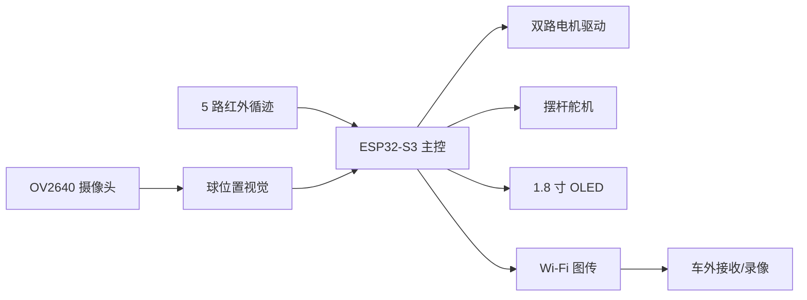

# dsh-git — 车载平衡滚球运动控制系统

> 2026 年全国大学生电子设计竞赛 H 题工程仓库：循线小车 + 车载平衡滚球机构 + 摄像头位置检测 + 图传记录。
>
> 这是一份**可评审的工程原型**：包含需求拆解、控制方案、固件骨架、视觉原型、仿真与测试、BOM 和 Git 工作流。仓库里的代码用于方案验证和答辩展示，实车参数仍需按现场标定。

[](https://github.com/lllo42ss/dsh-git/actions/workflows/ci.yml)

## 题目要点

| 项目 | 要求 | 本仓库对应 |
|---|---|---|
| 循线 | 黑色环形线，线宽 1.8±0.2 cm，AB/CD 1.5 m，BC/DA 半圆 R=0.5 m | `firmware/` 红外循迹 + `simulation/line_follow.py` |
| 行驶 | 一圈 ≤20 s，停车偏差 ≤2 cm | 状态机、编码器里程计、停车基准线 |
| 滚球 | 静止时 O→+5 cm→-5 cm，≤5 s，误差 ≤1 cm | 摆杆角度闭环 + 球位置串级 PID |
| 行进滚球 | 通过 B、整圈 ≤30 s，球稳定在中心/任意点，误差 ≤1 cm | 视觉反馈 + 前馈补偿 |
| 图传 | 车载发送、车外接收显示并录像回放 | `vision/` + `docs/protocol.md` |
| 报告 | 方案、理论、电路程序、测试、规范 | `docs/` |

## 系统结构



控制采用串级结构：

1. **循迹环**：红外阵列偏差 → PID → 左右轮差速。
2. **球位置环**：摄像头像素坐标 → 摆杆坐标 → 球位置 PID → 目标摆角。
3. **摆角环**：舵机角度反馈/编码器 → 角度 PID → PWM。
4. **前馈**：小车加减速时，按纵向加速度补偿摆杆目标角，抑制球的前后窜动。

详见 [架构说明](docs/architecture.md) 与 [控制设计](docs/control-design.md)。

## 快速开始

```bash
git clone <your-repo-url> dsh-git
cd dsh-git
python -m unittest discover -s tests -v
python scripts/check_repo.py
```

固件使用 PlatformIO：

```bash
cd firmware
pio run
pio run -t upload
pio device monitor
```

视觉原型需要 OpenCV：

```bash
python -m pip install opencv-python
python vision/ball_tracker.py --source 0
```

## 仓库结构

```text
dsh-git/
├── docs/          需求、架构、控制、测试、协议、ADR
├── firmware/      ESP32-S3 固件骨架（PlatformIO）
├── hardware/      BOM、引脚表、框图
├── vision/        球位置视觉与图传协议
├── simulation/    球-摆杆与循迹模型
├── tests/         纯 Python 单元测试
├── scripts/       仓库自检
└── .github/       CI、Issue/PR 模板
```

## Git 工作流

- 主干：`main`，始终保持可测试。
- 功能分支：`feature/<topic>`，通过 `--no-ff` 合并，保留决策轨迹。
- 修复分支：`fix/<topic>`，合并前必须跑测试。
- 标签：`v0.1.0` 为控制闭环原型，`v1.0.0` 为提交版。
- 提交信息：Conventional Commits，例如 `feat(vision): add ball centroid tracker`。
- 详细约定见 [CONTRIBUTING.md](CONTRIBUTING.md)。

## 当前状态

- [x] 题目拆解与评分映射
- [x] 串级控制方案与仿真
- [x] 固件骨架、视觉原型、单元测试
- [x] CI、Issue/PR 模板、ADR
- [ ] 实车参数标定
- [ ] 完整图传录像回放
- [ ] 赛区现场测试记录

## 许可

MIT，见 [LICENSE](LICENSE)。比赛题目文字与图片版权归命题方所有，本仓库只做工程实现记录。

## Git 演示

本仓库刻意保留了一条小型但完整的分支/合并/标签历史，用于演示 Git 工作流：

- eature/line-tuning：功能分支 + --no-ff 合并；
- ix/ball-sign：修复分支；
- 0.1.0：控制原型标签；
- 1.0.0：提交版标签。

