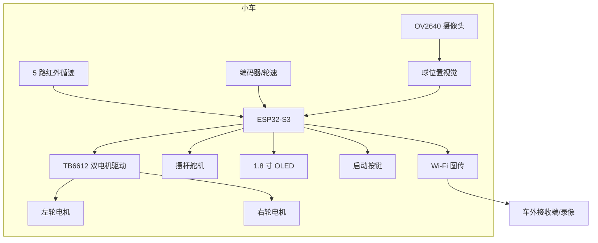
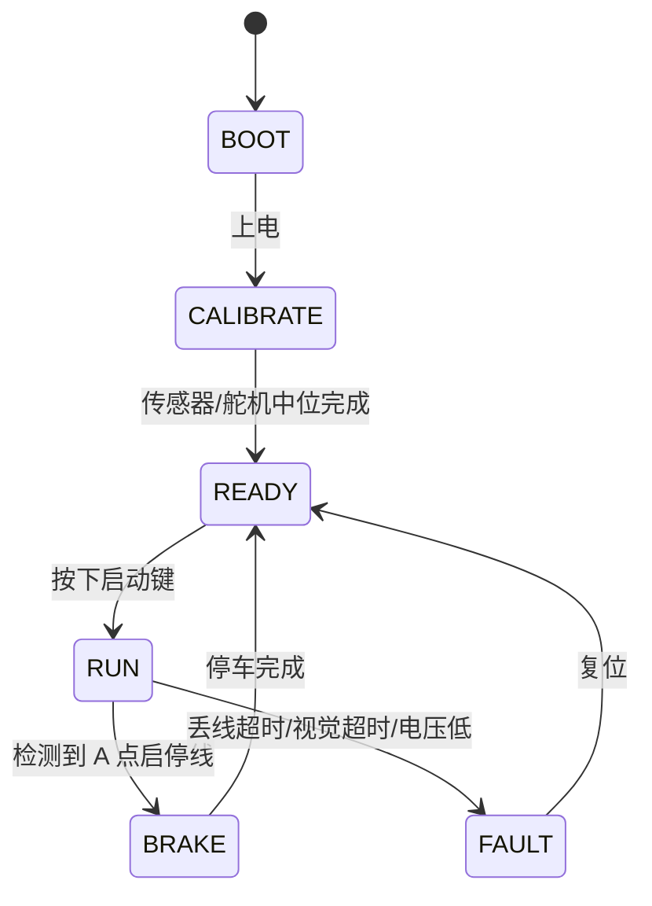

# 系统架构

## 1. 总体框图



## 2. 控制分层

| 层 | 周期 | 输入 | 输出 |
|---|---:|---|---|
| 图传/录像 | 15–30 fps | 摄像头 JPEG | 车外显示、录像 |
| 球位置视觉 | 30–50 Hz | 灰度图 ROI | 球位置 cm、置信度 |
| 球位置环 | 50 Hz | 目标位置、视觉位置 | 目标摆角 |
| 摆角环 | 200 Hz | 目标角、舵机反馈 | 舵机 PWM |
| 循迹环 | 100 Hz | 5 路红外、编码器 | 左右轮 PWM |
| 状态机/显示 | 20 Hz | 按键、计时、故障 | OLED、蜂鸣器 |

## 3. 运行状态机



## 4. 关键设计选择

### 4.1 主控

ESP32-S3 双核：

- Core 0：Wi-Fi 图传、串口协议、日志；
- Core 1：循迹、球位置环、舵机 PWM、状态机。

选择理由：摄像头接口、Wi-Fi、足够 PWM/ADC、社区资料多；成本低于“主控 + 独立图传”的双板方案。

### 4.2 球位置视觉

OV2640 固定在摆杆上方，俯视凹槽。先做 ROI 裁剪，再做灰度阈值/轮廓，输出球心像素坐标；用四点标定映射到摆杆厘米坐标。

不把摄像头用于循迹，满足题目“循迹只能使用红外光电模块”的限制。

### 4.3 摆杆驱动

舵机 + 曲柄/连杆把旋转转为摆杆俯仰。舵机内置位置反馈，控制上作为角度环；外环是球位置环。

### 4.4 通信

- 图传：ESP32-S3 Wi-Fi AP/STA + HTTP MJPEG，车外浏览器/VLC 接收；
- 调试：USB CDC 串口，输出 CSV 日志；
- 控制：车外只做显示/录像，不参与实时闭环，避免无线抖动影响控制。

## 5. 供电与抗干扰

```text
2S/3S 锂电池
  ├─ 电机驱动（直接，经保险丝/开关）
  ├─ 5V UBEC → 舵机
  └─ 3.3V LDO → MCU/摄像头/红外
```

- 电机地与逻辑地单点汇合；
- 舵机电源并 470–1000 µF 电解 + 0.1 µF 陶瓷；
- 摄像头排线远离电机线；
- 红外发射管脉冲供电，避免环境光饱和。

## 6. 失效降级

| 故障 | 检测 | 动作 |
|---|---|---|
| 视觉超时 >150 ms | 时间戳 | 保持上一目标角，1 s 后回中 |
| 全白/全黑丢线 >200 ms | 红外全无效 | 降速，按最后误差方向搜索 |
| 电池 <3.4 V/cell | ADC | 禁止启动，OLED 告警 |
| 舵机堵转 | 电流/角度误差 | 限制 PWM，蜂鸣器告警 |
| 图传断流 | 发送队列 | 本地继续控制，记录日志 |
